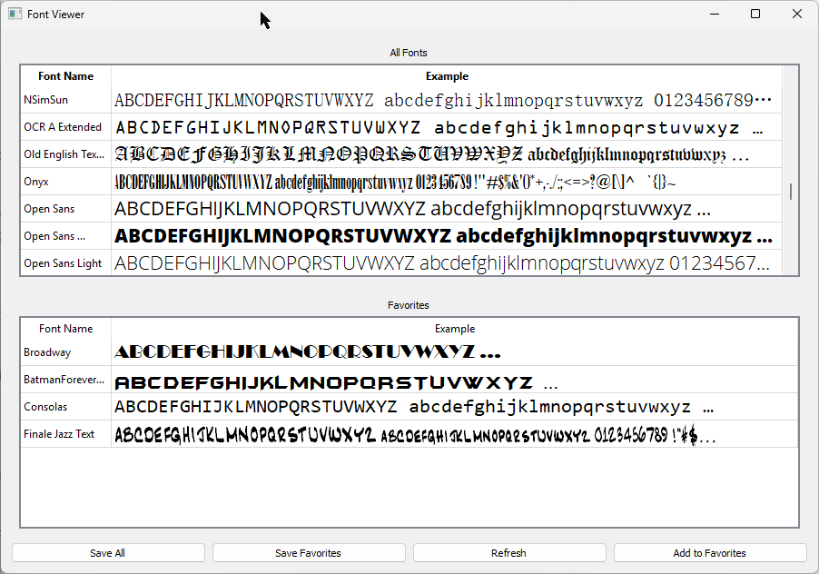

# MyFonts
A simple Python app to quickly show all your fonts, along with examples of all letters, numbers and (common) punctuation.



Requires Python 3.10 to 3.14 (Anaconda, or something to run Python with). PySide6 provides wheels for Windows (x64 or ARM64), macOS 13 or newer, and Linux with glibc 2.34 or newer (2.39 on ARM64). To install the requirements, run:
```shell
pip install -r requirements.txt
```

To run the app, run:
```shell
python FontViewerApp.py
```

Enhancements are planned. Stay tuned!